# Architecture & Data Flow

## 1. Topology

<!-- BEGIN:FLOW -->
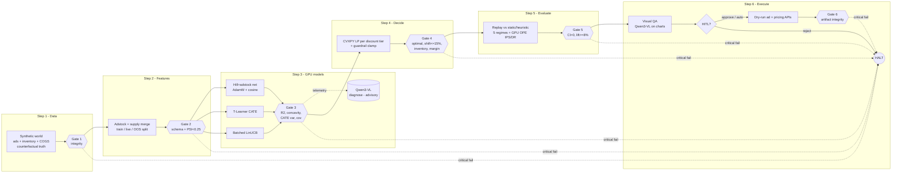
<!-- END:FLOW -->

LangGraph nodes: `ingest -> features -> models -> optimize -> evaluate -> review -> execute`, plus `halt`.
Every node runs a **pre-hook** (previous gate must have passed) and a **post-hook** (its own gate is evaluated,
persisted to `outputs/validation/step_validation_report.json` and embedded in `AgentState.gates`). A critical failure
sets `halted`, and the conditional edge routes to `halt`. `review` (Step 6 pre-phase) runs the LLM visual QA and decides
whether a human must approve; it uses LangGraph `interrupt()` with a `MemorySaver` checkpointer, resumed through
`AgentService.resume()` (Flask `/api/hitl/*`, Streamlit HITL tab). In batch mode (`run_all.py`) approval is
auto-granted and the audit log records `auto_approved` with the reasons.

`Planner.plan()` (`src/agent/tools.py`) is the single decision function; the benchmark replays exactly this function,
so evaluation measures what the agent would do.

## 2. Math

Steady-state response of channel *c* at constant daily spend *b*:
`x = b / (1 - lambda_c)`, `r_c(b) = beta_c * x^S_c / (K_c^S_c + x^S_c)`, with `S_c in [0.5, 1]` so `r_c` is concave
(enforced by parameterisation). The training model uses a learnable geometric kernel (length 21) over daily spend and a
day-of-week multiplier.

Per discount tier *d* the planner solves the LP

```
max  m(d) * sum_c r_c  -  sum_c b_c          m(d) = mk * (1 + L(d)) * AOV * (GM - d * rho)
s.t. r_c <= a_ck * b_c + c_ck  (tangents)    lo_c <= b_c <= hi_c    sum_c b_c <= B_max
```

`lo/hi = prev * (1 +/- 15%)`, `rho` = promo redemption share, `L(d)` = CATE-derived relative conversion lift
(curvature `(d/0.10)^0.8` is a modelling prior), `mk` = bandit creative multiplier. Net per day adds the constant
`organic * (m(d) - AOV * GM)`; the tier with the best net among the guardrail-allowed tiers wins, then the guardrail
engine re-verifies/clamps. An online ridge-RLS calibrator (`OnlineCalibrator`) rescales channel responses from observed
conversions after each cycle so the agent adapts to regime shifts.

OPE: target = greedy LinUCB trained on the first half of the logged bandit data; evaluated on the held-out half with
IPS `1[a=pi(x)]/p * r` and Doubly Robust `q(x,pi(x)) + 1[a=pi(x)]/p * (r - q(x,a))` (propensities clipped at 0.01);
lift CI from 10,000 GPU bootstrap resamples.

## 3. Validation gates (step contracts)

| Gate | Input artifact | Critical checks |
|---|---|---|
| 1 Data | raw daily frame | row count, no NaN/Inf, spend/COGS >= 0, capacity util in [0,1], timestamp continuity, Pydantic row schema |
| 2 Features | feature frame, spec, train/live windows | decay in [0,1), FeatureSpec + FeatureRow schema, finite, **max PSI < 0.25** |
| 3 Models | response / uplift / bandit reports + curves | R2 (train, holdout) >= 0.80, finite params, monotone + concave curves, CATE variance bounds, finite & PD bandit covariance |
| 4 Optimize | guardrailed `AllocationPlan` | solver optimal, budget <= B_max, shift <= 15%, discount 0 if util > 0.85, unit margin >= 0.20 |
| 5 Evaluate | benchmark + OPE results | DR CI lower bound > 0, lift vs static and heuristic >= 8%, zero replay violations |
| 6 Execute | execution payload + artifacts + audit | required artifacts exist/non-empty/parse (hashes -> `artifact_hashes.json`), plan approved + guardrail-clean, audit has LLM/mock entries |

Non-critical (warn) checks: CATE correlation with truth, IPS/DR sign agreement, agent beats static in every regime.

## 4. Data dictionary (`outputs/data/raw_daily.parquet`)

| Column | Meaning |
|---|---|
| `date`, `day_idx`, `dow` | calendar |
| `spend_<channel>` | daily ad spend ($) for search, social, video, display, affiliate |
| `inventory_util` / `capacity_util` | supply utilisation in [0,1] (discounts suppressed above 0.85) |
| `price_sens`, `loyalty`, `recency`, `mobile_share`, `weekend` | audience context features |
| `aov`, `unit_cogs`, `gross_margin` | unit economics |
| `conversions` | observed total conversions (3% log-normal noise) |
| `true_organic`, `true_contrib_<channel>` | ground-truth counterfactual decomposition (never used for training) |

Other tables: uplift cohorts (`treated`, `outcome`, `true_cate`), bandit log (`arm`, `creative`, `tier_idx`, `propensity`,
`reward`, `logp_*`). Windows: train `[0, 540)`, live `[540, 720)`, out-of-sample replay `[720, 900)` (25 weekly cycles).

## 5. Output artifacts

`outputs/validation/` (step report, schema audit, drift report, artifact hashes) · `outputs/evaluation/`
(benchmark_comparison.csv, ope_replay_results.json, regime_breakdown.json) · `outputs/metrics/` (system_metrics.json,
gpu_telemetry.json, step_timings.csv) · `outputs/logs/` (pipeline_execution.jsonl, agent_decision_audit.jsonl,
flask_access.jsonl) · `outputs/charts/` · `outputs/screenshots/`.

## 6. Lineage

<!-- BEGIN:LINEAGE -->
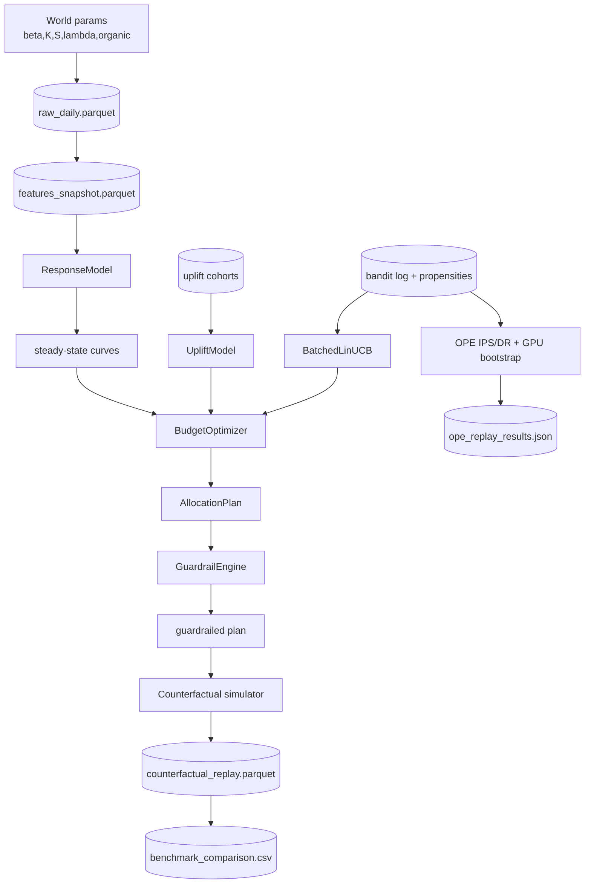
<!-- END:LINEAGE -->

## 7. Gate status & metrics (auto-generated)

<!-- BEGIN:GATES -->
| Gate | Stage | Result | Checks (pass/total) | Failed |
|---|---|---|---|---|
| 1 | Raw & Synthetic Data Integrity | PASS | 7/7 | - |
| 2 | Feature Engineering & Drift Check | PASS | 5/5 | - |
| 3 | Model Calibration & Convergence | PASS | 11/11 | - |
| 4 | Optimization & Guardrail Compliance | PASS | 8/8 | - |
| 5 | Offline Evaluation & OPE Significance | PASS | 7/7 | - |
| 6 | Execution & Output Artifact Integrity | PASS | 8/8 | - |

**Pass rate: 6/6 gates (100%)**
<!-- END:GATES -->

<!-- BEGIN:METRICS -->
_Last run: 2026-11-24 21:38 UTC on `NVIDIA GeForce RTX 3090` (24575 MB VRAM, CUDA 12.8)_

| KPI | Value |
|---|---|
| Net yield lift vs static | **+36.4%** |
| Net yield lift vs heuristic | **+18.5%** |
| Target (>= +8%) met | yes |
| OPE DR lift (95% CI) | +27.9% [+27.1%, +28.6%] |
| OPE IPS lift | +19.4% |
| GPU bootstrap (10,000 resamples) | 35 ms |
| Guardrail violations in replay | 0 |
| Plan latency mean / p95 | 11.3 / 18.3 ms |

| Regime | Agent lift vs static | Agent lift vs heuristic | Violations |
|---|---|---|---|
| baseline | +38.7% | +18.0% | 0 |
| demand_shock | +41.4% | +22.8% | 0 |
| inventory_crunch | +6.5% | +2.7% | 0 |
| high_cac | +44.0% | +19.0% | 0 |
| margin_squeeze | +103.0% | +53.9% | 0 |

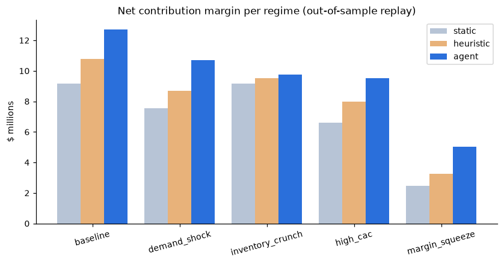
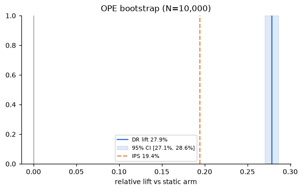
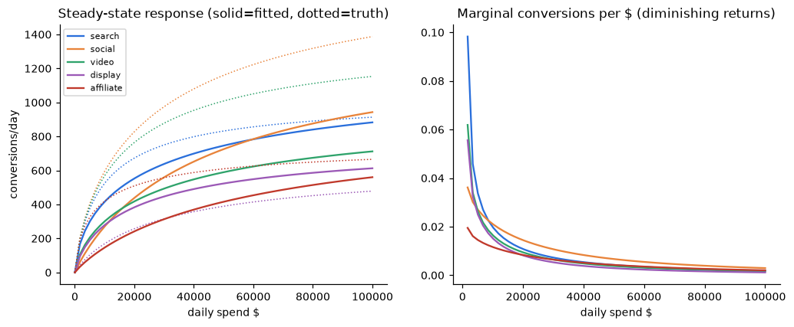
<!-- END:METRICS -->

## 8. Honest limitations

* Synthetic data: the simulator and the models share the same functional family (Hill+adstock, concave), so fit quality
  and lift are optimistic relative to real data. Response parameters (K, beta) are only weakly identifiable even here;
  the R2 gate checks predictive fit, not parameter recovery.
* The promo lever is generous by construction (30% redemption, up to +25% relative lift at 10% discount).
* The VLM visual QA is advisory and can be wrong (it has flagged monotone curves as non-monotone); numeric Gate 3 is
  the source of truth for curve shape, which is why a visual anomaly only escalates to a human.
* Mock ad/pricing APIs only; execution is always dry-run.

<!-- BEGIN:SCREENSHOTS -->
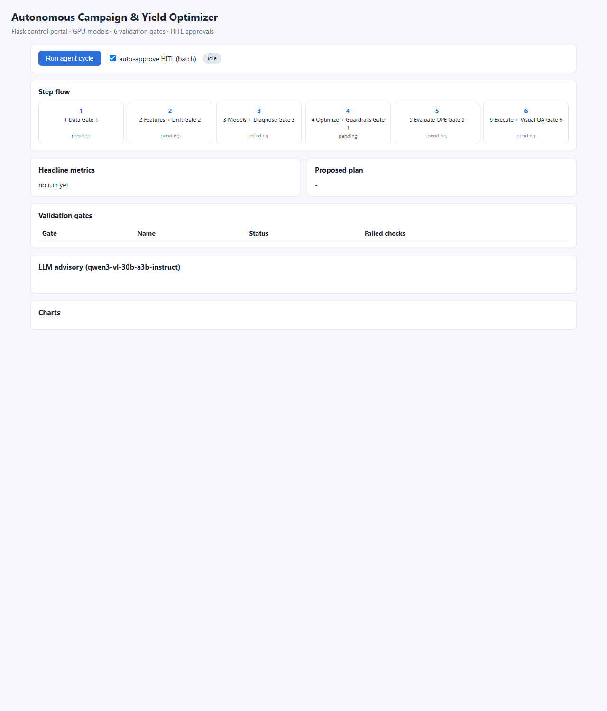
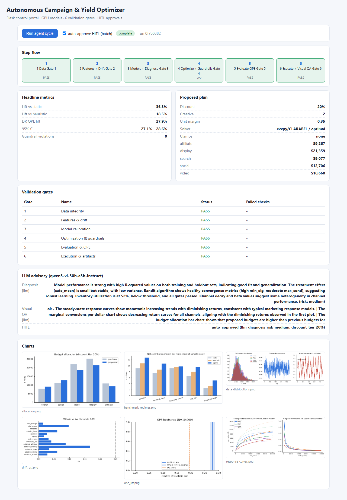
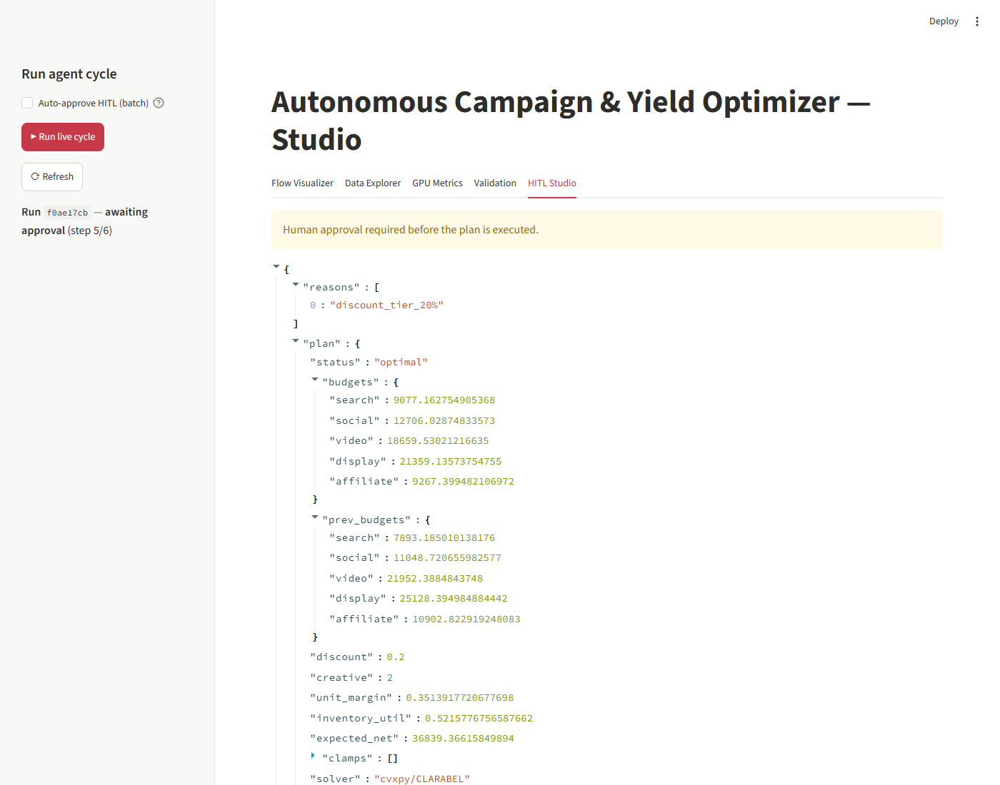
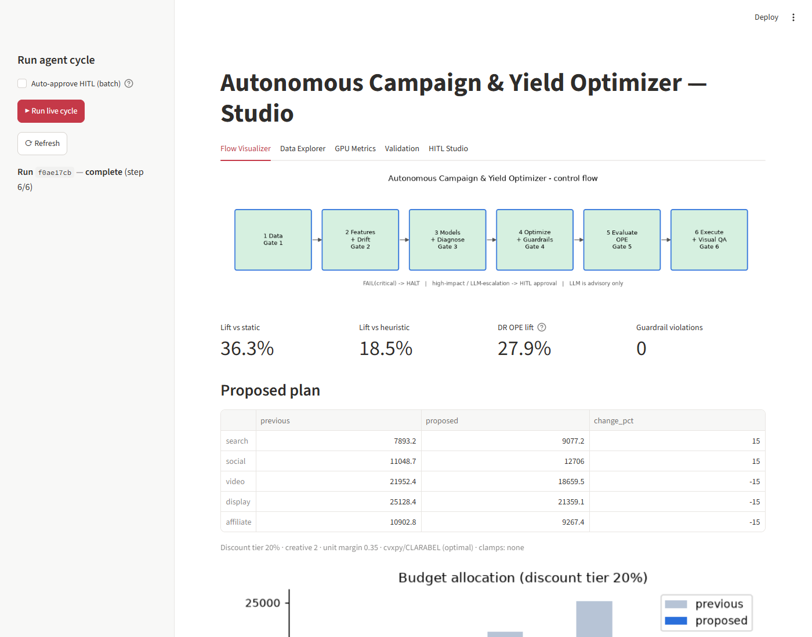
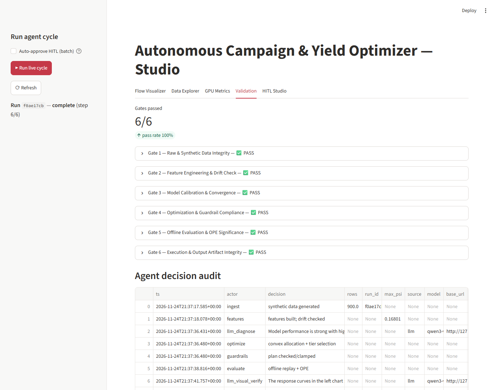
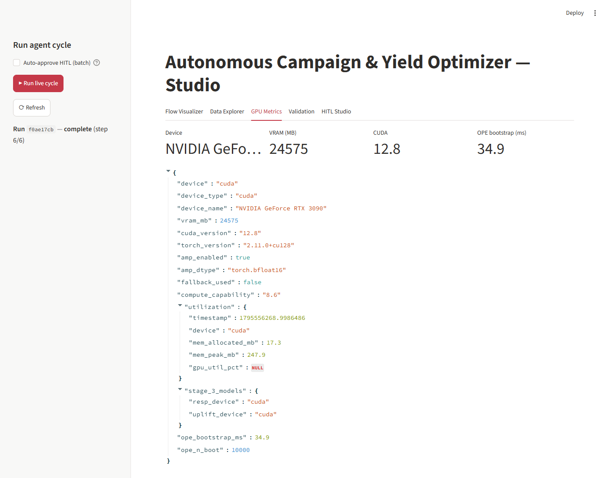
<!-- END:SCREENSHOTS -->
