# Autonomous Campaign & Yield Optimizer Agent

GPU-accelerated, LangGraph-orchestrated agent that maximises **Incremental Net Contribution Margin** across paid
channels and promotional levers:

```
Net Yield = (Incremental Conversions x AOV x Gross Margin %) - Ad Spend - Promo Discount Cost
```

It combines a PyTorch Hill+adstock response network, a two-head T-Learner (CATE of discounts), a batched GPU LinUCB
bandit (creative x discount-tier arms), and a CVXPY convex budget allocator, wrapped in six validation gates,
financial guardrails, human-in-the-loop approval, offline replay + GPU doubly-robust OPE, two UIs (Flask and
Streamlit) and an advisory local multimodal LLM (`qwen3-vl-30b-a3b-instruct`).

> **Important:** all results below come from a **synthetic world with known ground truth** (see
> `src/data/synthetic_generator.py`). They demonstrate that the system works end to end, not real-world uplift.

## Control flow

<!-- BEGIN:FLOW -->
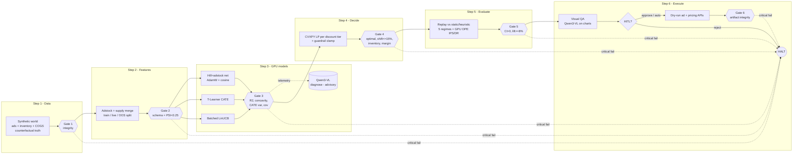
<!-- END:FLOW -->

## Live validation status

<!-- BEGIN:GATES -->
| Gate | Stage | Result | Checks (pass/total) | Failed |
|---|---|---|---|---|
| 1 | Raw & Synthetic Data Integrity | PASS | 7/7 | - |
| 2 | Feature Engineering & Drift Check | PASS | 5/5 | - |
| 3 | Model Calibration & Convergence | PASS | 11/11 | - |
| 4 | Optimization & Guardrail Compliance | PASS | 8/8 | - |
| 5 | Offline Evaluation & OPE Significance | PASS | 7/7 | - |
| 6 | Execution & Output Artifact Integrity | PASS | 8/8 | - |

**Pass rate: 6/6 gates (100%)**
<!-- END:GATES -->

## Live metrics

<!-- BEGIN:METRICS -->
_Last run: 2026-11-24 22:04 UTC on `NVIDIA GeForce RTX 3090` (24575 MB VRAM, CUDA 12.8)_

| KPI | Value |
|---|---|
| Net yield lift vs static | **+36.3%** |
| Net yield lift vs heuristic | **+18.5%** |
| Target (>= +8%) met | yes |
| OPE DR lift (95% CI) | +27.8% [+27.1%, +28.6%] |
| OPE IPS lift | +19.6% |
| GPU bootstrap (10,000 resamples) | 33 ms |
| Guardrail violations in replay | 0 |
| Plan latency mean / p95 | 9.5 / 14.7 ms |

| Regime | Agent lift vs static | Agent lift vs heuristic | Violations |
|---|---|---|---|
| baseline | +38.7% | +18.0% | 0 |
| demand_shock | +41.4% | +22.8% | 0 |
| inventory_crunch | +6.5% | +2.7% | 0 |
| high_cac | +43.9% | +18.9% | 0 |
| margin_squeeze | +103.0% | +53.9% | 0 |

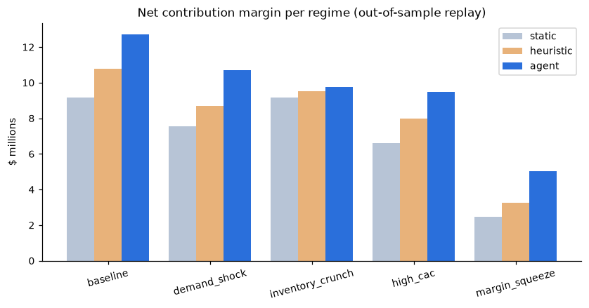
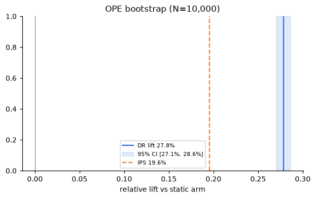
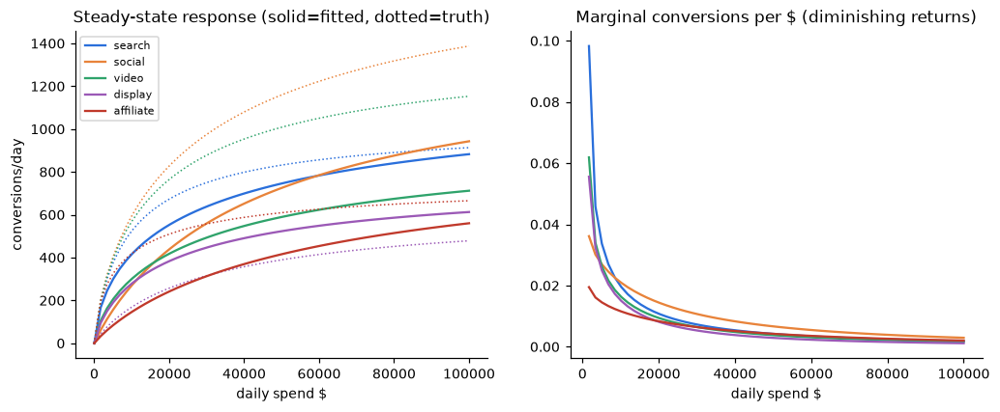
<!-- END:METRICS -->

## End-to-end example scenarios

Six examples push a market situation through the same six-step flow (data, features + drift, GPU models,
optimize + guardrails, offline replay + OPE, execute / HITL) using the models of a trained run. They are defined in
`src/agent/scenarios.py`, run by `run_all.py`, and available interactively in the **Scenario Studio** tab of the
Streamlit app (pick an example, or *Run ALL scenarios*). Results: `outputs/scenarios/scenario_results.json`,
`outputs/charts/scenario_*.png`, and one screenshot per scenario in `outputs/screenshots/scenario_*.png`.

<!-- BEGIN:SCENARIOS -->
| # | Scenario | Outcome | Discount | Lift vs static | Lift vs heuristic | Step statuses (1-6) | HITL |
|---|---|---|---|---|---|---|---|
| 1 | 1. Business as usual | completed | 20% | +38.7% | +18.0% | P P P P P P+H | approval_required |
| 2 | 2. Demand shock | completed | 20% | +41.4% | +22.8% | P P P P P P+H | approval_required |
| 3 | 3. Inventory crunch | completed | 0% | +6.5% | +2.7% | P P P P W P+H | approval_required |
| 4 | 4. CAC inflation | completed | 20% | +43.9% | +18.9% | P P P P P P+H | approval_required |
| 5 | 5. Margin squeeze (COGS spike) | completed | 10% | +103.0% | +53.9% | P P P P P P+H | approval_required |
| 6 | 6. Live feature drift (pipeline HALT) | **HALT** | - | - | - | P F - - - - | halted |

_P = pass, P+H = pass but human approval required, W = warn (below +8% target), F = fail, - = skipped_

#### 1. Business as usual
Normal demand and healthy inventory. The agent shifts budget (max 15% per channel per cycle) toward the channels with the highest marginal return and picks the discount tier with the best net margin.

_Expected:_ Large yield lift vs both baselines, all gates pass, high discount tier needs human approval.

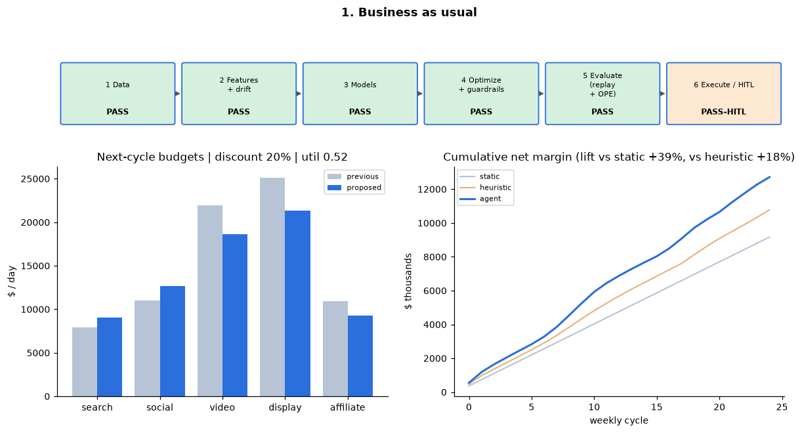

#### 2. Demand shock
Search response collapses (-45%) while display surges (+35%). The online calibrator re-weights channels from observed conversions, so the agent follows the market within a few cycles.

_Expected:_ Static spend keeps feeding the collapsed channel, so the agent's lift is even larger.


#### 3. Inventory crunch
Capacity utilisation spikes above 0.85. Promotions would create demand the supply cannot serve, so the guardrail suppresses every discount; the decision snapshot is taken at utilisation 0.92.

_Expected:_ Discount forced to 0%, lift comes from reallocation only (smallest of the five scenarios).

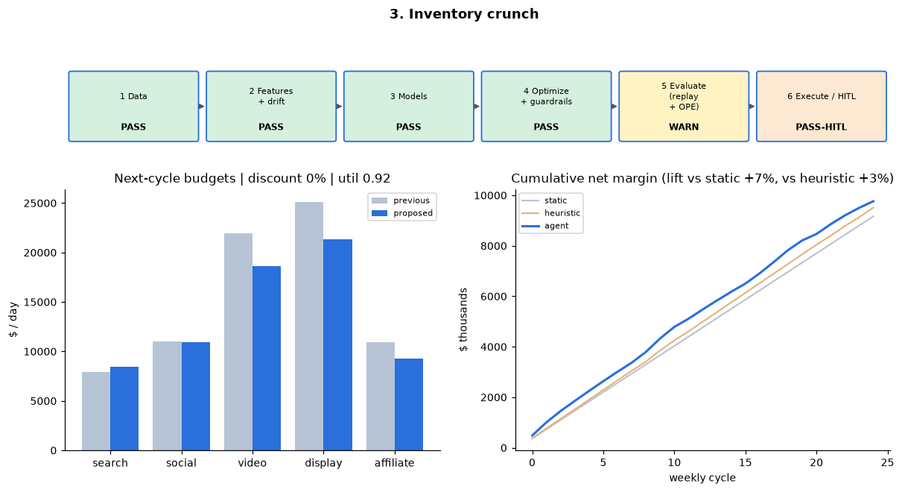

#### 4. CAC inflation
Social and video saturate later (K x1.7) so each extra dollar buys fewer conversions. The agent moves spend to cheaper channels and, when marginal ROI < 1, spends less than the static plan.

_Expected:_ Lift vs static is large because the static plan over-spends on now-expensive channels.

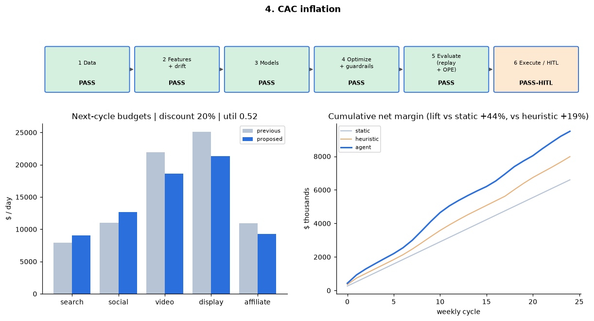

#### 5. Margin squeeze (COGS spike)
Gross margin falls from 55% to 38%. The unit-margin floor (>= 20%) removes the 20% discount tier and the optimizer trims unprofitable spend.

_Expected:_ Discount tier capped below 20%; biggest relative lift because the static plan burns margin.

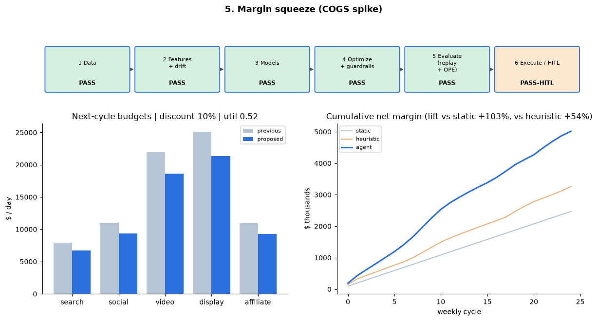

#### 6. Live feature drift (pipeline HALT)
The live window's price-sensitivity feature shifts by +0.35. Gate 2 (PSI < 0.25) fails, the pipeline halts before any model is trusted and nothing is executed.

_Expected:_ Gate 2 FAIL (critical) -> HALT; steps 3-6 skipped; no budget change is sent.

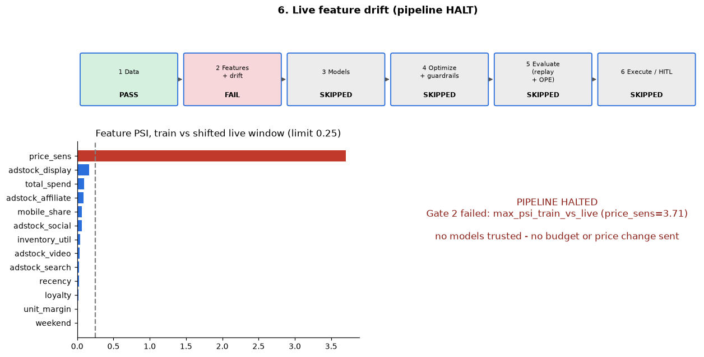

<!-- END:SCENARIOS -->

## Data lineage

<!-- BEGIN:LINEAGE -->
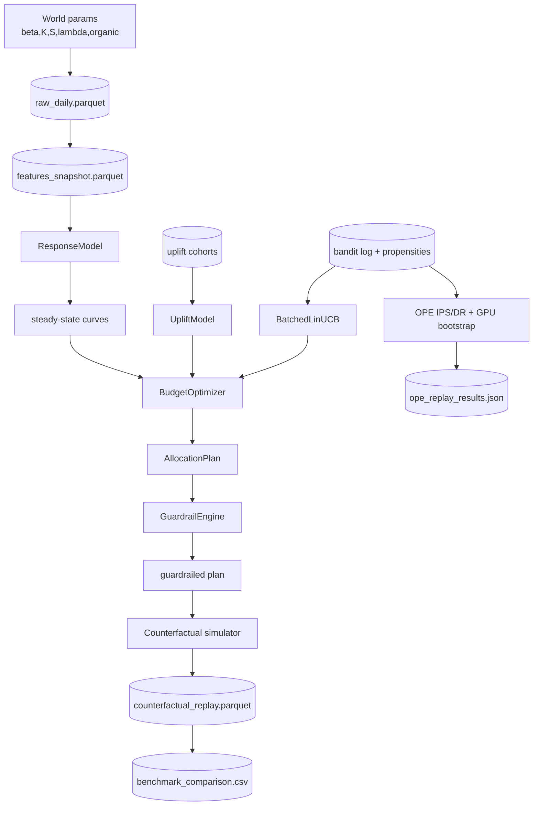
<!-- END:LINEAGE -->

## Quick start

```bash
python -m venv .venv && .venv\Scripts\activate           # Python 3.10+ (developed on 3.12)
pip install torch --index-url https://download.pytorch.org/whl/cu128   # or the CPU wheel
pip install -r requirements.txt
playwright install chromium                               # optional; run_all falls back to Edge/Chrome
python run_all.py                                         # full pipeline + gates + charts + UI screenshots + docs
python run_all.py --device cpu --skip-ui-shots            # CPU-only, no browsers
pytest -q                                                 # tests (CPU always; CUDA tests skip without a GPU)
python -m src.api.flask_app                               # Flask portal   http://127.0.0.1:5000
streamlit run src/ui/streamlit_app.py                     # Streamlit studio
```

`run_all.py` exits non-zero if any gate fails or the +8% yield target is missed.

## Local LLM (advisory only)

`src/llm/client.py` talks to an OpenAI-compatible server. Base URL: `LOCAL_LLM_BASE_URL` (default
`http://127.0.0.1:1234`); if that does not list `qwen3-vl-30b-a3b-instruct` it probes ports 1234, 8000, 11434, 8080.
Two uses: (1) text root-cause diagnosis of telemetry after Gate 3, (2) visual QA of the response-curve and allocation
charts before execution. Output is Pydantic-validated JSON; **it can only add HITL escalations, never relax a
guardrail**, and every call is logged to `outputs/logs/agent_decision_audit.jsonl` with `source: llm|mock`. If the
server is down a deterministic mock is used so CI and gate pass-rate never depend on it.

## Screenshots

<!-- BEGIN:SCREENSHOTS -->
**Flask control portal**

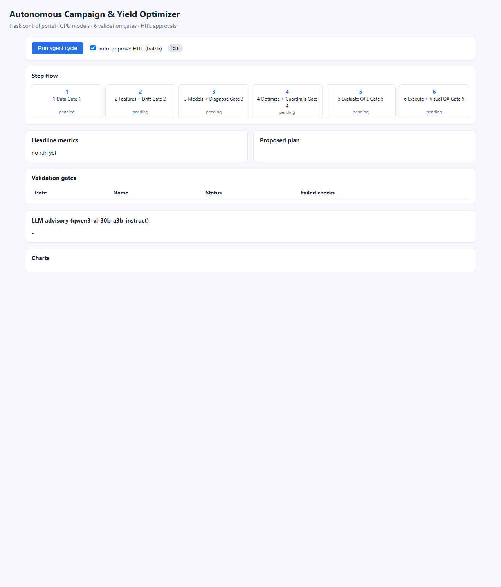
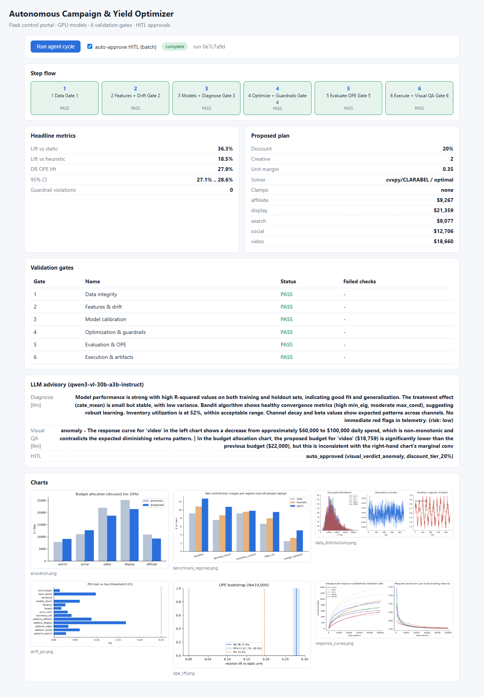

**Streamlit - live run, HITL approval, validation, GPU**

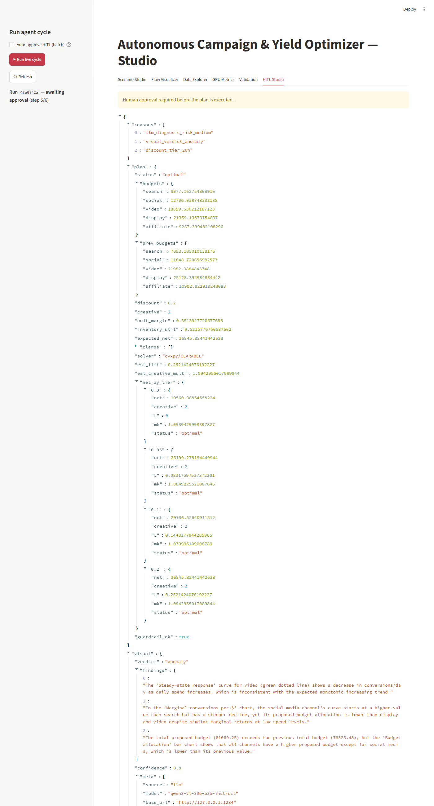
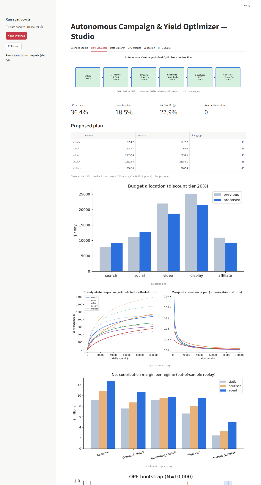
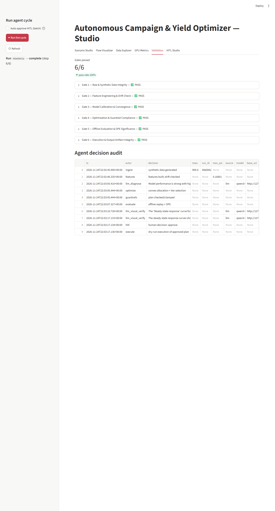
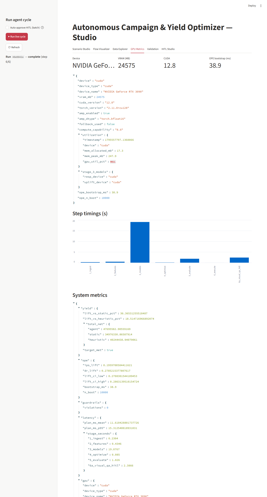

**Streamlit - Scenario Studio (end-to-end examples)**

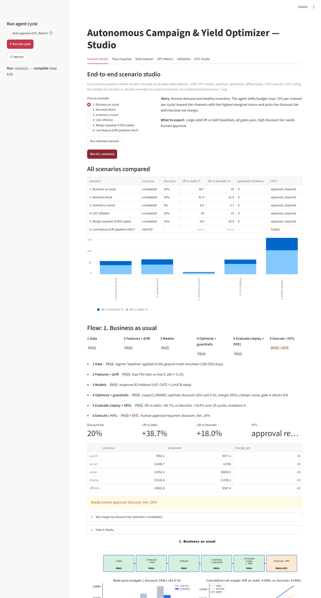


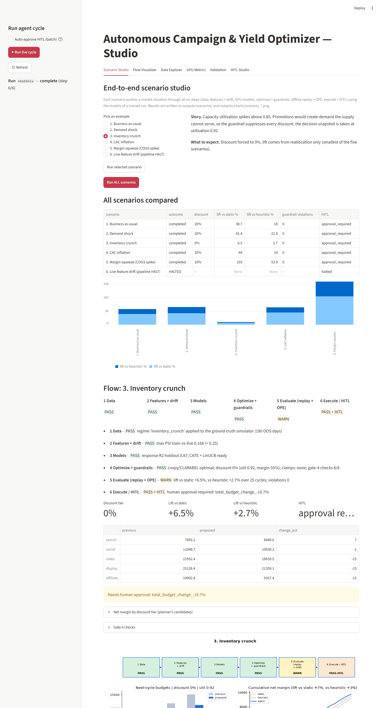

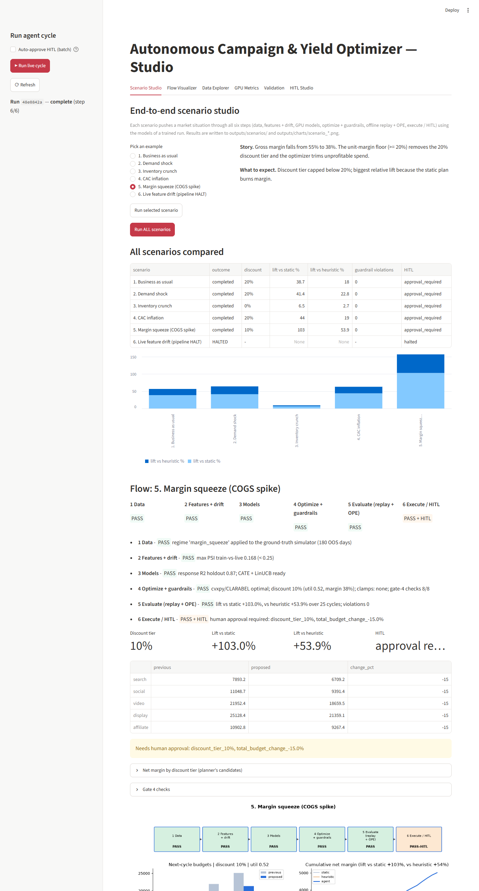
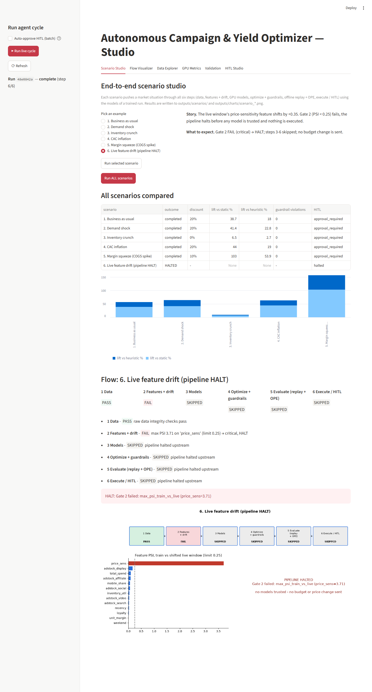

<!-- END:SCREENSHOTS -->

## Presentation

`presentation/Autonomous_Campaign_Yield_Optimizer.pptx` - 12-slide overview (objective, six-step flow and gates, GPU models, guardrails, HITL + local LLM, results, scenarios, UIs, limits).

## Layout

See `ARCHITECTURE_AND_DATA_FLOW.md` for topology, data dictionary, math, and per-step contracts.
Config: `config/agent_config.yaml`, `config/guardrails.yaml`. Artifacts: `outputs/`.
